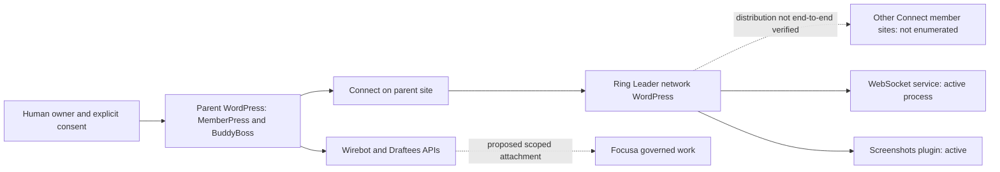

# Network deployment topology

Evidence collected November 10, 2026, at approximately 11:00–11:45 PM PST. Read-only production inspection by Wirebot directly; bounded source research by a Wirebot-assigned sub-agent. No deployment, restart, user impersonation, membership change or mutating API call.

## Observed topology

**Deployment observation:** parent and network sites occupy separate account roots on the same inspected production hosting environment. Generalized host only; private addresses and account paths omitted. LiteSpeed, MariaDB and Redis are active services. Their exact use per request was not traced. Separate account roots are not proof of full tenant isolation.

| Component | Installed version | Checkout HEAD observed | Meaning |
|---|---|---|---|
| Both WordPress sites | 7.1.4 | Site root HEAD unavailable | WP CLI observation |
| Parent BuddyBoss Platform / Pro | 2.14.4 / 2.11.0 | Not collected | Active plugins |
| Parent MemberPress / Developer Tools | 1.12.11 / 1.3.7 | Not collected | Active plugins |
| Parent Connect | 0.4.1 | e842d97a5bad689698a30444dfdd51bbabc133ec | Active; differs from reviewed repository head |
| Parent Core | Header version empty | fec5b1e57a2f2fab54e6dc09eb389e1690b57158 | Active; reviewed source is placeholder |
| Network Ring Leader | 0.2.0 | 32f0d32c4be52882dcac60c1d0b4ed08cd5748ca | Active; differs from reviewed repository head |
| Network WebSockets | 0.2.0 | f3464c7ca9d58b1fcb2ac0252e3468ec3be5d36c | Active plugin and running service; differs from reviewed source |
| Network Screenshots | 0.2.0 | b6538544847304ea17086fa9e7c55211abf23734 | Active; matches reviewed repository HEAD |

A checkout HEAD does not prove clean working files or the executable artifact hash. No source/deployment equivalence is claimed. The service working directory points inside the network WebSockets plugin; service user is its hosting account. Active/running is not socket handshake, permission or message-delivery proof.

**Deployment observation:** parent also has active sew-the-wire, wire-draftees, wirebot-provisioning and sew-pwa plugins, plus SSO/passkey, event-bus, membership-guard and content-webhook must-use files. Network cache-warming and screenshot-cleanup cron hooks are registered. Parent provisioning-health, Draftees and content-dispatch hooks are registered. Scheduling does not prove successful recent execution. No queue was consumed or cron run triggered.

## Safe member journey trace and limits

| Stage | Owning component | Evidence / current result | Remaining proof |
|---|---|---|---|
| Registration | Parent WordPress / MemberPress | Deployment observation: active membership stack | No account created; registration validation and email receipt untested |
| Level and role | MemberPress, WordPress | Source: Ring Leader has current-membership bridge; signed cached claims alone are insufficient | Actual allowed/revoked member mapping untested |
| Shared login | Parent SSO, Connect, Ring Leader | Source: token exchange and handoff implemented; trust review required | No token minted; successful and denied cross-site sessions untested |
| Directory | Connect / Ring Leader | API observation: parent members GET 502 on two observations | Upstream cause and permitted directory projection unverified |
| Growth Partner | Parent social/relationship interfaces | API observation: anonymous GET 401 rest_forbidden | Relationship grant, field-level sharing and revocation untested |
| Discussion / message board | sew-the-wire / BuddyBoss | Deployment source: public GET and logged-in POST registrations; no messages sent | Object visibility, member moderation and receiver readback untested |
| Distributed content | Ring Leader -> Connect | API observation: parent feed/opportunities GET 200 | Correct tier filtering, member-site rendering and freshness untested |
| Notifications | WebSockets / existing notification services | Deployment observation: service running | Handshake, channel isolation, delayed/duplicate delivery and receiver notification untested |

This traces responsibility and observed boundaries; it is **not a completed member journey test**. Non-mutating scope prevents creating accounts, purchasing membership, posting discussion or proving a new notification end to end. Other member sites were not enumerated. Dormant versus healthy cannot be resolved from an active plugin alone.

## Source anchors

Historical baseline is preserved at [Big Picture](../bigpicture.mdx) and [relationships](../wirebot_chat_gpt_brainstorm.mdx). Immutable source citations and reviewed repository revisions are retained in [gaps](2026-11-10-network-gaps.md). Fresh route observations and timestamps are in [API matrix](2026-11-10-network-api-matrix.md).
